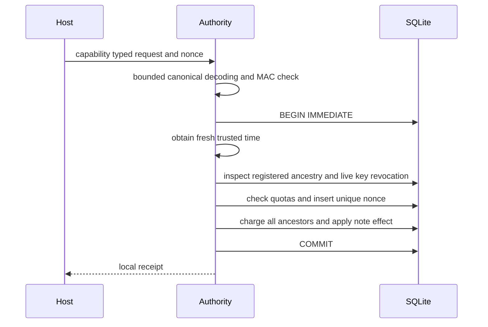

# Design and security invariants

## Credential grammar and trust

```text
credential = base64url_unpadded(canonical_claims) "." base64url_unpadded(mac)
mac = HMAC-SHA256(issuer_key, canonical_claims)
```

The algorithm is fixed in code; no untrusted `alg` negotiation exists. JSON keys are sorted, separators fixed, strings ASCII-escaped, and list sets sorted/unique. Decoding rejects duplicate or unknown fields, alternate encodings, noncanonical JSON, oversized tokens, malformed ancestry, and non-integer budgets. MAC comparison uses `hmac.compare_digest`; key generation in experiments uses `secrets.token_bytes(32)`. MAC keys are memory-only; SQLite stores key fingerprints and IDs, never raw keys.

The trusted issuer creates roots and reissues attenuated children. A holder has only a bearer credential and cannot recompute its MAC. `verify` authenticates claims but is not an authorization decision. Model-supplied dictionaries can only become an `Operation`; they cannot call privileged issuance/revocation methods. Resource IDs are exact fictional names, not filesystem paths or wildcard grants.

## Attenuation lattice

For child C and parent P:

```text
scopes(C) subset scopes(P)
resources(C) subset resources(P)
expiry(C) <= expiry(P)
calls(C), units(C), bytes(C) <= corresponding limits(P)
```

The child records the complete ordered ancestor ID chain, with a maximum depth of eight. Every registered ancestor's stored ancestry must match that prefix. Runtime enforcement checks each ancestor's resource/scope/time/key state, not only the leaf. For operation cost u and every ancestor a including the leaf:

```text
used_calls(a) + 1 <= max_calls(a)
used_units(a) + u <= max_units(a)
u <= max_bytes(a)
```

Append units are actual UTF-8 payload bytes. Read units are actual returned UTF-8 bytes; a partial codepoint at the read boundary is omitted. Read limits must also fit every per-operation cap. Clear costs one call and zero byte units. Local notes have a one-million-byte size ceiling.

## Transaction linearization and failure



The write lock is acquired before live state checks. A revocation committed while an operation was waiting is therefore observed. Time is reread after waiting, closing the stale-verification-clock gap. A revocation waiting behind a valid transaction linearizes afterward; it does not retroactively undo that committed effect. Effect errors, replay conflicts, and quota denials roll back nonce and counters with the effect.

Nonce uniqueness is per capability, not global business-intent idempotence. A crash after COMMIT can leave the caller unsure whether the result arrived; a retry is denied as replay rather than returning a stored response. Remote side effects are intentionally absent, so no distributed exactly-once claim is made.

## Complexity and operating assumptions

MAC/JSON work is O(credential bytes), bounded by 12,000 encoded characters and 8,192 claim bytes. Authorization performs O(depth) indexed token/key lookups and counter updates, depth at most nine including the leaf. Exact scope/resource membership sets are bounded. SQLite serializes writes; this favors simple local correctness over high write concurrency. File-backed WAL databases and a trusted SQLite implementation/filesystem are required. Multi-process callers need the same issuer-owned keys supplied through a separately secured host mechanism; this repository does not persist or provision secrets.
