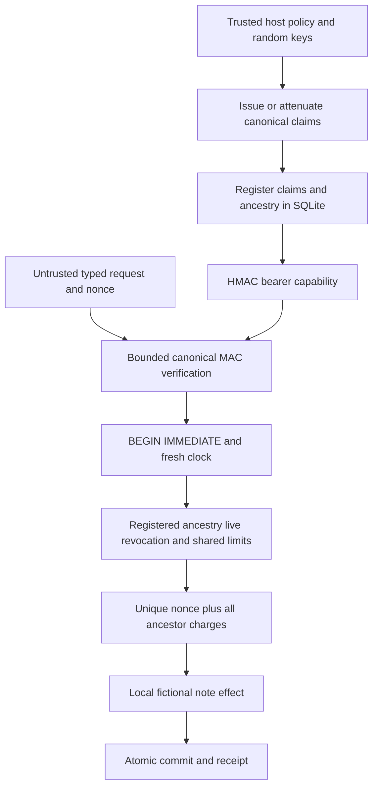

# Architecture

`authority.py` defines strict immutable claims/operations and the trusted `Authority`. HMAC keys stay in issuer memory; registered bodies, fingerprints, revocations, usage, nonces, and notes live in a file-backed SQLite database. Every invocation opens its own connection; writes serialize at `BEGIN IMMEDIATE`.

`verify()` authenticates encoding/MAC/identity/time only. `execute()` is the live authorization boundary and combines checks, nonce, quotas, and effect transactionally. The model-facing operation allowlist exposes no issuer methods. `experiments.py` generates temporary keys/databases and reports synthetic contract outcomes without credentials.

See [DESIGN](credential-and-quota-rules.md) for attenuation mathematics, clock/rollback behavior, and threat assumptions; [REVIEW](authorization-regressions.md) and [EXPERIMENTS](replay-and-quota-trials.md) contain executed evidence.
